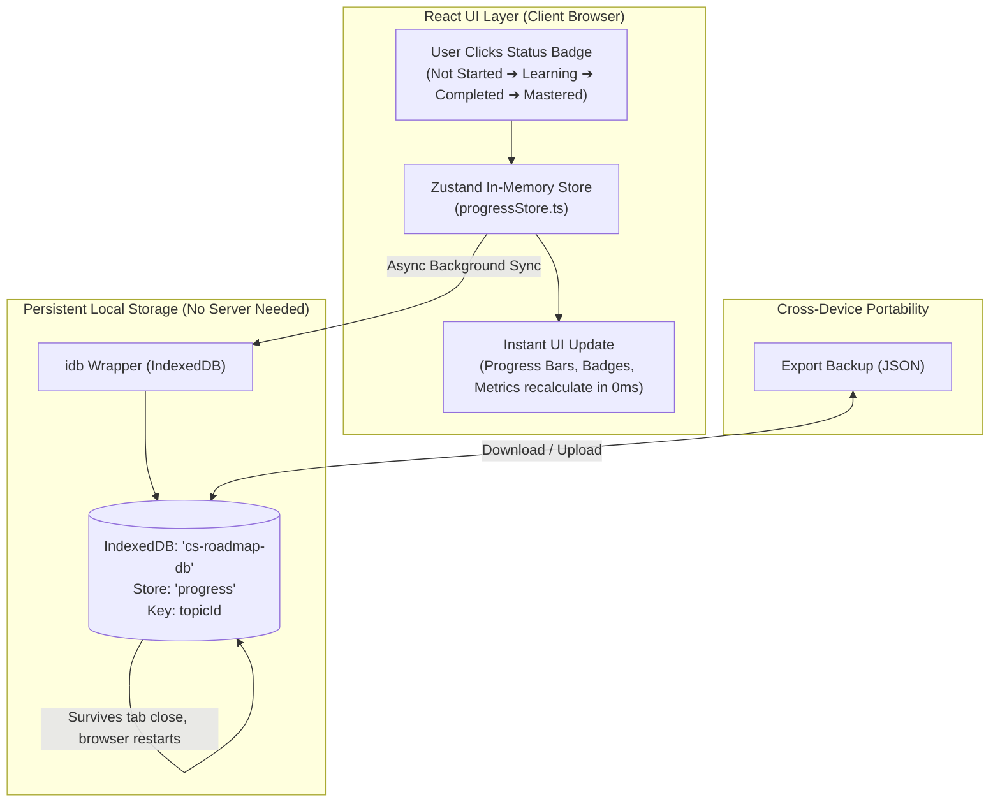

# Computer Science Master Roadmap — Interactive Knowledge Graph & Study Tracker

An interactive, expandable Computer Science curriculum mapping the full landscape of Computer Science: **12 major domains**, **75+ academic subjects**, **200+ detailed topics & subtopics**, foundational mathematics & statistics, and interdisciplinary relationship edges.

Designed with a **clean, modern light-themed palette** and a **spacious interactive Knowledge Graph** for distraction-free learning and curriculum exploration.

---

## 💾 How Data Storage Works on this Static Webpage

One of the most important architectural features of this website is that it is a **100% static, client-side single-page application (SPA)**. It requires **no backend server**, **no accounts**, and **no cloud database subscription**. You can host it for free on GitHub Pages, Vercel, Netlify, or run it directly offline from your computer.

Because there is no remote database server, **all your data—including topic status selections, the Mastered state, study notes, custom resources, and settings—is stored directly and persistently inside your web browser**.



---

### 1. Selection of States & The Mastery State Lifecycle

Every topic across the computer science catalogue moves through a deterministic 4-stage learning lifecycle:

| Status Icon | Status Key | Label | Meaning & Academic Criteria |
|:---:|:---|:---|:---|
| ⚪ | `not_started` | **Not Started** | Default initial state. Topic is unexplored. |
| 📖 | `learning` | **Learning** | In active study. You are reading textbooks, watching lectures, or taking a course. |
| ✅ | `completed` | **Completed** | Core comprehension achieved. You understand the fundamental theorems and algorithms. |
| ⭐ | `mastered` | **Mastered** | **Highest proficiency level.** You can implement concepts from scratch, solve expert problem sets, teach the concept, or apply it to production research. |

#### How the "Mastered" State Works:
- Clicking the status badge on any topic row, subject view, or topic deep-dive cycles through:  
  `not_started` ➔ `learning` ➔ `completed` ➔ `mastered` ➔ `not_started`.
- In the topic detail view, you can also directly jump to any state using the status selector buttons.
- Both **Completed** and **Mastered** topics count toward your numerical completion percentage:
  $$\text{Completion \%} = \left\lfloor \frac{\text{completed} + \text{mastered}}{\text{total topics}} \times 100 \right\rfloor$$
- **Mastered** topics receive distinct visual prominence:
  - Specially highlighted purple accent badge (`text-purple-700 bg-purple-50 border-purple-200`).
  - Dedicated segment in the multi-tier progress bars across the Dashboard, Roadmap, and Knowledge Graph.
  - Tracked as a distinct milestone metric in the **Progress & Settings** overview and sidebar counters.
  - Automatically records the exact timestamp (`completedAt`) when mastery was reached.

---

### 2. Where the Data is Stored: IndexedDB (`cs-roadmap-db`)

Rather than losing state when you close the tab, the application uses **IndexedDB**—the browser's industrial-grade client-side transactional object database—via the lightweight [`idb`](https://github.com/jakearchibald/idb) promise wrapper.

#### IndexedDB Database Structure:
- **Database Name**: `cs-roadmap-db`
- **Schema Version**: `1`
- **Object Store 1 (`progress`)**:
  - Key path: `topicId` (string, e.g., `"avl-trees"`, `"relational-algebra"`, `"transformers"`)
  - Value: `TopicProgress` JSON object
- **Object Store 2 (`settings`)**:
  - Key path: `key` (e.g., `"user"`)
  - Value: `UserSettings` JSON object (theme preferences, graph filters, display options)

#### Stored Data Schema (`TopicProgress`):
```typescript
interface TopicProgress {
  topicId: string;                     // Unique identifier (e.g., "dijkstra-algorithm")
  status: 'not_started' | 'learning' | 'completed' | 'mastered';
  notes: string;                        // Your Markdown personal study notes
  resources: Resource[];                // External URLs, books, lecture papers added by you
  startedAt?: string;                   // ISO 8601 date when status transitioned to 'learning'
  completedAt?: string;                 // ISO 8601 date when status transitioned to 'completed' or 'mastered'
  lastUpdated: string;                  // ISO 8601 timestamp of most recent edit
  estimatedHoursOverride?: number;     // Optional custom duration estimate
}
```

---

### 3. Why IndexedDB Instead of `localStorage`?

| Comparison Point | IndexedDB (Used Here) | Traditional `localStorage` |
|---|:---|:---|
| **Storage Capacity** | Up to several **gigabytes** (browser disk quota) | Limited to ~5 MB maximum |
| **Data Types** | Structured JSON objects, dates, binary data, nested arrays | Plain text strings only |
| **I/O Performance** | Asynchronous & non-blocking (UI never freezes) | Synchronous & blocking |
| **Data Integrity** | Transactional ACID operations | Unchecked string overwrites |
| **Query Flexibility** | Direct object store lookups by topic ID | Manual `JSON.parse` of large blobs |

---

### 4. Reactive State Flow: Zustand + IndexedDB Synchronization

To ensure the user interface feels instantaneous:
1. **Zustand In-Memory Store (`src/store/progressStore.ts`)**:  
   Maintains a reactive in-memory map `progressMap: Record<string, TopicProgress>`.
2. **Instant UI Feedback**:  
   When you click to mark a topic as **Mastered**, Zustand updates the in-memory state in 0 milliseconds. All progress bars, badges, percentages, and knowledge graph node stats instantly reflect the change.
3. **Background Persistence**:  
   Concurrently, an asynchronous write transaction commits the change to IndexedDB (`saveTopicProgress`).
4. **App Initialization**:  
   When you open the page or refresh, `loadProgress()` reads all records from IndexedDB and populates the store before rendering.

---

### 5. Portability, Backups & Cross-Device Sync

Because IndexedDB is local to the specific browser and device you are using:

#### How to Transfer Progress Between Devices:
1. Navigate to **Progress & Settings** (`/progress`).
2. Click **Export Backup (JSON)**:  
   Downloads a file named `cs-roadmap-backup-YYYY-MM-DD.json` containing your entire study record (all statuses, mastery states, notes, resources, and settings).
3. On your other computer, laptop, or tablet, open the site, go to **Progress & Settings**, and click **Import Backup**.
4. The file is validated and merged into the new browser's IndexedDB automatically.

#### 100% Privacy Guarantee:
- **No analytics or tracking cookies**.
- **No data leaves your computer**.
- You own your study data completely in open standard JSON format.

---

## 🕸️ Knowledge Graph & Clean Visual Layout

The Knowledge Graph view (`/graph`) is powered by `@xyflow/react` and renders a curriculum dependency graph containing **170 curated academic edges** across Computer Science:

- **Spacious, Uncongested Block Layout**:
  - Domain clusters are spaced with **920px horizontal pitch** and **820px vertical pitch**.
  - Subject cards within each cluster are organized into **clean 2-column micro-grids** with generous 70px+ whitespace gaps, preventing blocks from overlapping.
  - When filtering to a single domain, nodes dynamically arrange into an expanded, readable **3-column canvas**.
- **Clean Light Theme**:
  - High-contrast typography with slate-900 titles, crisp domain color badges, topic counts, and mastery percentages.
  - Elegant smoothstep connector edges color-coded by academic relationship type.
- **Academic Relationship Types**:
  - `foundation_of`: Theoretical or mathematical basis
  - `prerequisite_of`: Formal required dependency
  - `uses`: Core operational reliance
  - `application_of`: Real-world engineering realization
  - `implements`: Software or architectural implementation
  - `related_to`: Interdisciplinary cross-pollination
  - `contains`: Sub-discipline containment

---

## 🏛️ Academic Taxonomy (12 Domains)

| Domain | Description | Color Accent |
|---|---|---|
| **Core Computer Science** | Algorithms, data structures, OS, compilers, databases, networks, automata | Indigo |
| **Software Engineering** | Design patterns (SOLID, GoF), testing (TDD), CI/CD, microservices, architecture | Blue |
| **Mathematics** | Discrete math, linear algebra, calculus, graph theory, abstract algebra, optimization | Emerald |
| **Probability & Statistics** | Probability theory, inference, Bayesian models, stochastic processes, regression | Teal |
| **Computer Engineering & Hardware** | Digital logic, CPU architecture, memory hierarchy, pipelining, embedded systems | Orange |
| **AI & Machine Learning** | Statistical learning, deep neural nets, Transformers, LLMs, computer vision, RL | Violet |
| **Data Science & Engineering** | ETL pipelines, stream processing (Kafka), big data (Spark), data warehousing | Cyan |
| **Systems & Infrastructure** | Linux internals, virtualization, cloud computing, Kubernetes, SRE | Sky |
| **Cybersecurity & Cryptography** | Cryptographic primitives, network defense, penetration testing, zero-trust | Red |
| **Web, Mobile & App Development** | Web standards, React architecture, state management, REST/GraphQL, native mobile | Amber |
| **HCI & Design** | Cognitive interaction models, UX research, design systems, accessibility (WCAG) | Pink |
| **Graphics, Robotics & Applied** | 3D rendering pipeline, shaders, robotics kinematics, quantum computing | Amber |

---

## 🛠️ Tech Stack

- **Framework**: [React 19](https://react.dev/) + [TypeScript](https://www.typescriptlang.org/)
- **Bundler & Dev Server**: [Vite 8](https://vite.dev/)
- **Graph Visualization**: [@xyflow/react](https://reactflow.dev/) (React Flow)
- **Styling**: [Tailwind CSS v4](https://tailwindcss.com/)
- **Reactive State Management**: [Zustand](https://zustand.docs.pmnd.rs/)
- **Client-Side Persistence**: [IndexedDB via idb](https://github.com/jakearchibald/idb)
- **Client Routing**: [React Router v7](https://reactrouter.com/)
- **Iconography**: [Lucide React](https://lucide.dev/)
- **Client-Side Search**: [Fuse.js](https://fusejs.io/)

---

## 💻 Local Development Setup

### 1. Prerequisites
- **Node.js**: v18.0.0 or higher (v22 LTS recommended)
- **npm** (or pnpm / yarn)

### 2. Install Dependencies
```bash
npm install
```

### 3. Run Development Server
```bash
npm run dev
```
Open your browser at `http://localhost:5173/`.

### 4. Build for Production
```bash
npm run build
```
This compiles TypeScript (`tsc -b`) and generates production bundles in the `dist/` folder.

### 5. Preview Production Build Locally
```bash
npm run preview
```

---

## 🚢 Static Site Deployment

The application is completely static and can be deployed anywhere with zero backend configuration:

### GitHub Pages
1. In `vite.config.ts`, set `base: '/<repo-name>/'` (or `'/'` if using a custom domain or root repository).
2. Run `npm run build`.
3. Deploy the `dist/` directory to your `gh-pages` branch.

### Vercel / Netlify / Cloudflare Pages
1. Connect your GitHub repository.
2. Build command: `npm run build`
3. Output directory: `dist`
4. All client-side SPA routing works directly out of the box.
